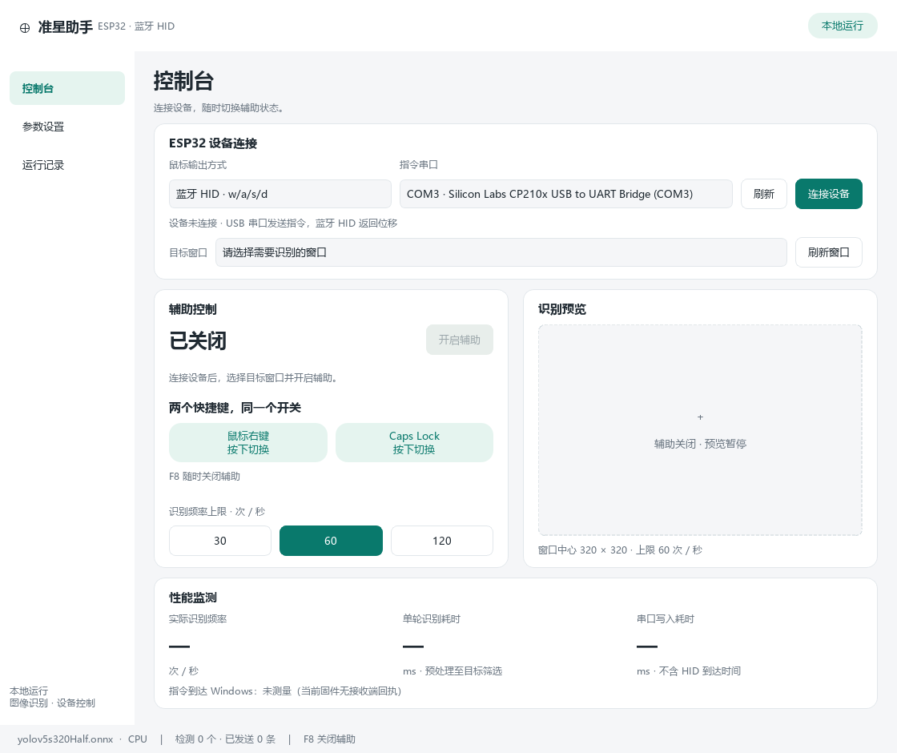

# 准星助手 · ESP32 桌面版

基于现有 AI-Aimbot 新增的 Windows 桌面程序，按照提供的「准星助手」UI 原型实现控制台、参数设置和运行记录。通过目标窗口截图进行 YOLOv5 ONNX 人物检测，再沿用已经跑通的 ESP32 蓝牙鼠标串口协议发送修正指令。

**桌面入口：`main_ui.py`，双击入口：`start_ui.bat`。** 项目已精简为桌面版，旧命令行入口、训练/导出代码和无关示例已移除。参数统一通过界面设置。

## 已实现功能

- 真实串口扫描、连接/断开、目标窗口选择。
- 右键或 Caps Lock 按下时切换同一个辅助状态；F8 关闭辅助。
- 目标窗口客户区中心截图，支持窗口移动、截图尺寸调整和底部遮罩。
- ONNX FP16/FP32 输入适配、RGB 预处理、等比例缩放补边、人物筛选和 NMS。
- 范围内优先选择接近准星的目标，通过相邻帧位置保持目标；支持瞄准高度、死区、移动倍率与修正上限。
- 30 / 60 / 120 次每秒识别上限；设备发送单独限制为最多 30 条每秒。
- 真实截图预览、检测框、瞄准点、识别频率和耗时统计。
- 关闭后停止新截图、识别与发送，丢弃尚未发送的旧推理结果；窗口不在前台时暂停截图和输出。
- 串口拔出或运行异常时自动关闭辅助、释放串口并记录错误。
- 本地配置持久化、最近 200 条事件和轮转日志。

## 快速安装

环境：Windows 10/11、64 位 Python。当前开发验证使用 Python 3.13；先用 CPU 完成配置，再考虑 GPU。

在项目目录打开 PowerShell：

```powershell
python -m venv .venv
.\.venv\Scripts\python.exe -m pip install -r requirements.txt
.\.venv\Scripts\python.exe main_ui.py
```

安装完成后可以双击 `start_ui.bat`。无需激活虚拟环境，也无需安装 Torch 或 CUDA；`requirements.txt` 是唯一的运行依赖清单。

仓库自带 `yolov5s320Half.onnx`（默认）及较大的 `yolov5m320Half.onnx`，可以在参数设置中选择。

## 第一次使用

1. 将当前已能控制光标的 ESP32 接到电脑，在 Windows 蓝牙设置中确认已连接 `ESP Mouse`。
2. 关闭 IDF Monitor、Arduino Serial Monitor、旧版辅助等占用串口的程序。
3. 打开桌面版，刷新串口，选择对应 COM 口并点击 **连接设备**。
4. 打开需要识别的窗口，点击 **刷新窗口**，选择该窗口。开始时可用显示人物图片的测试窗口验证检测。
5. 参数保持默认：CPU、320 截图、置信度 0.40、倍率 0.40、死区 12。
6. 点击 **开启辅助**，切回目标窗口。或切回目标窗口后按右键/Caps Lock 开启。
7. 再按右键或 Caps Lock 关闭；**F8 始终只关闭**。回到助手前台会暂停截图与输出，保留开启状态。

助手自身窗口处于前台时，右键和 Caps Lock 不切换辅助，避免编辑参数时误触；请使用界面按钮。快捷键不拦截原始输入，右键仍传给目标程序，Caps Lock 仍改变系统大小写状态。

完整操作、调参和排错见 **[使用教程](docs/使用教程.md)**。



## 当前硬件协议与限制

```text
Windows 截图 → ONNX 检测 → 目标选择 → USB 串口（115200）
    → ESP32 收到 w/a/s/d → 蓝牙 HID → Windows 鼠标
```

| 字节 | 方向 |
| --- | --- |
| `w` | 向上 |
| `a` | 向左 |
| `s` | 向下 |
| `d` | 向右 |

沿用 `esp32_ble_mouse.py` 中已有的固定步长适配：每次选误差较大的一个轴，固件决定移动距离，适配器按约 10 counts 处理，每秒最多发送 30 条。**倍率和修正上限作用于量化前数值，不能让此固件执行任意 dx/dy，也不能实现同时双轴移动。** 死区用于减少准星附近来回摆动。

串口打开只表明命令通道可用，不能证明蓝牙 HID 已连接。当前固件无心跳或 HID 接收回执，程序无法自动识别单独的蓝牙断连，无法测量指令到达 Windows 的真实延迟。UI 显示「未测量」；串口写入耗时只测量本机写调用。

USB HID 选项暂不可选，需要匹配的 HID 固件/协议。继续使用已经能够控制光标的 ESP32 蓝牙鼠标固件。

## 配置与目录

配置：`%LOCALAPPDATA%\AimAssist\settings.json`，日志：同目录 `runtime.log`，最多保留 2 个历史文件，每个约 1 MB。重启后辅助始终关闭，不自动连接设备；窗口句柄不持久化，需重新选择。

```text
main_ui.py             桌面启动入口
start_ui.bat           Windows 双击启动
requirements.txt       运行依赖
aim_assist/
  ui.py                原生 PySide6 三页界面
  runtime.py           后台识别、设备生命周期与取消控制
  vision.py            ONNX 推理、NMS、目标选择
  windows.py           窗口枚举、客户区坐标、前台判断
  settings.py          配置校验与原子保存
esp32_ble_mouse.py     现有固件协议和方向测试 CLI
tests/                 算法、协议、后台状态回归测试
tests/fixtures/        截图联调使用的样例图片
tools/check_ui.py      不连接硬件的界面渲染检查
tools/check_pipeline.py 真实截图与模型的模拟串口联调
docs/使用教程.md        安装、操作、调参、排错
```

## 开发验证

```powershell
.\.venv\Scripts\python.exe -m pip install pytest
.\.venv\Scripts\python.exe -m pytest tests -q
.\.venv\Scripts\python.exe tools/check_ui.py
```

测试使用模拟串口与截图，不移动真实光标；界面检查生成 `artifacts/` 图片。真实设备、蓝牙链路和目标程序中的最终手感仍需要硬件联调。模型仅按类别 0 识别人形，不能区分敌我、阵营或遮挡关系。

实际执行记录及检查边界见 [开发验证记录](docs/验证记录.md)。

## 技术资料与原项目

- [ONNX Runtime Python API](https://onnxruntime.ai/docs/api/python/api_summary.html)
- [Qt 线程与对象](https://doc.qt.io/qtforpython-6.10/overviews/qtdoc-threads-qobject.html)
- [MSS 截图示例](https://python-mss.readthedocs.io/stable/examples.html)
- 基于 RootKit-Org/AI-Aimbot 开发；原项目授权见 [LICENSE](LICENSE)。旧版实现可通过 Git 历史查看。
